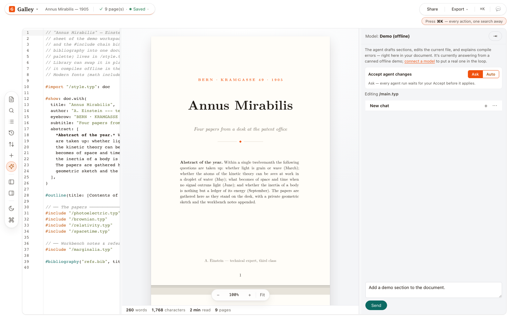
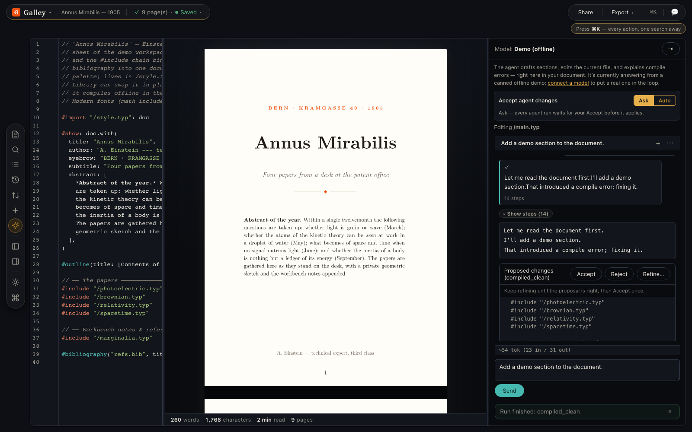
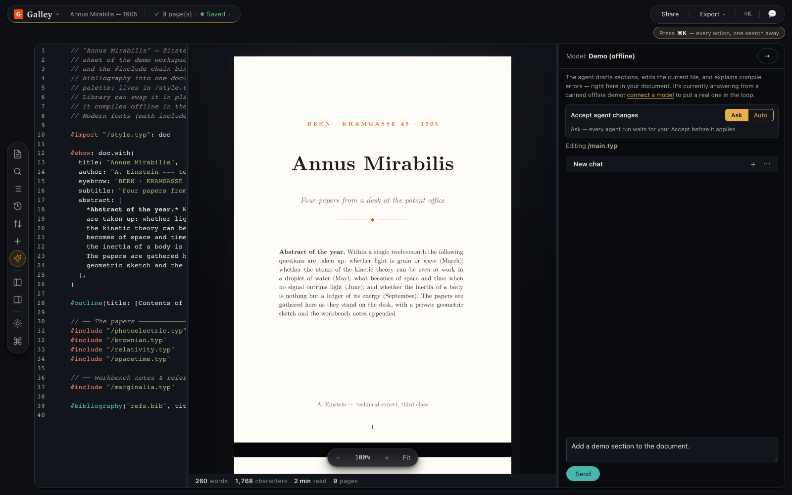

<p align="center">
  
</p>

<p align="center">
  <em>An open-source, <strong>local-first</strong>, <strong>model-agnostic</strong>,
  <strong>AI-native</strong> document workspace built on
  <a href="https://typst.app">Typst</a>.</em>
</p>

<p align="center">
  <a href="LICENSE"></a>
  <a href="https://typst.app"></a>
  <a href="docs/security-model.md"></a>
  <a href="CONTRIBUTING.md"></a>
  <a href="https://ko-fi.com/vito507767"></a>
</p>

<p align="center">
  <strong><a href="https://vitofico.github.io/galley/">▶ Try the live demo</a></strong> —
  no signup, no API key. Everything runs in your browser. It's meant for the
  built-in offline Demo agent — don't enter a real API key or GitHub token there.
</p>

<p align="center">
  <a href="https://vitofico.github.io/galley/">
    
  </a>
</p>

The workspace above is the bundled **Annus Mirabilis** demo: multiple Typst
files, a real nine-page compile, source editing and the offline Demo agent.
Open **Files** on the left rail to navigate the project; use **Export** for the
finished document or **⌘K / Ctrl+K** to find an action.

<details>
<summary>See an agent proposal and a different desk theme</summary>

<p align="center">
  <a href="docs/assets/readme-agent-review.png"></a>
</p>

The offline Demo model proposes a sample section without an API key. In **Ask**
mode, inspect the compiled proposal and choose **Accept** or **Reject**. The
screenshot was taken before Accept; the capture also verified that accepting
updated the document, compiled cleanly and survived a reload.

<p align="center">
  <a href="docs/assets/readme-editor-press-dark.png"></a>
</p>

In **Settings → Appearance**, choose **Studio** or **Press**, then **Light**,
**Dark** or **System**. **Artwork** and **Plain** control the desk background
independently. These choices change the workspace; document styling stays in
Typst and the **Change style** command.

</details>

A _galley proof_ is the preliminary typeset version you check and correct before
final layout — which is exactly this app's core loop: **compile → inspect →
correct → repeat.**

Galley is, conceptually, "AI-enhanced ShareLaTeX, but Typst instead of LaTeX, open source,
and not locked to one vendor's cloud or model." The differentiation is three
bets a cloud-only, single-vendor product structurally cannot make:

1. **Agentic, not autocomplete.** Typst compiles in milliseconds and emits
   structured, machine-readable diagnostics. That makes a tight
   **edit → compile → read errors → self-correct** loop cheap. _That loop is the
   product._
2. **Local-first.** The Typst compiler runs in the browser via WASM
   ([`typst.ts`](https://github.com/Myriad-Dreamin/typst.ts)). Your document and
   your compile stay on your machine. Server-side compile is an optional
   enhancement, never a dependency. _(See the honest [local-first
   definition](docs/vision.md#what-local-first-means-and-doesnt) — remote model
   endpoints still receive your document.)_
3. **Bring-your-own-model.** A provider abstraction runs the agent against any
   OpenAI-compatible endpoint, Anthropic, or a local Ollama. Model choice is
   config, never a fork.

## Status

Galley works end-to-end in the browser today: a CodeMirror editor with a live
SVG preview (typst.ts compiling in a Web Worker) and the human-in-the-loop
agent loop — **request → self-correct → diff → Accept/Reject → re-render**.
Bring your own model (any OpenAI-compatible endpoint, Anthropic, or a local
Ollama) or use the built-in offline **Demo** agent. Real-time collaboration is
opt-in — one-click **Share** upgrades a project to Yjs CRDT co-editing with the
**agent as a peer**, presence, and per-author attribution ([ADRs
0005–0012](docs/decisions)). Multi-file projects and templates, named versions
with visual compare, broad import/export (Markdown, LaTeX, Overleaf `.zip`,
Zotero/`.bib` and native source `.tar` in; PDF/PNG, source bundles and Git projections out), and opt-in MCP access behind an explicit
consent gate round it out. Self-host with Docker compose or Kubernetes; the
whole test suite (typecheck + unit + Playwright e2e) runs **in Docker**. See
the [CHANGELOG](CHANGELOG.md) for the full feature inventory and the
[roadmap](docs/roadmap.md) for what's next.

### Review the document before sharing

The writing/agent pane has deterministic, offline review tools. Open **Agent
panel** from the left rail if that pane is hidden.

| Open                                              | What you can review                                                                                                                                                                                                      |
| ------------------------------------------------- | ------------------------------------------------------------------------------------------------------------------------------------------------------------------------------------------------------------------------ |
| **Before you send**                               | Current preview SVG page count and optional portrait A4/Letter checks, plus source editorial markers. Results distinguish passed, failed and unavailable; stale previews do not pass. PDF export is compiled separately. |
| **Meaning changes to check** in a proposal diff   | Changed numbers, dates, units, citation keys and selected obligation/negation words alongside the normal diff. These are attention flags, not semantic or factual verification.                                          |
| **Document workbench → Living numbers**           | Import project CSV/JSON, name a scalar and link its exact document passage. Changed source versions flag potentially stale prose; preview and Accept a compiled refresh.                                                 |
| **Document workbench → Evidence lens**            | Manually link a claim passage to a retained source version and excerpt, mark your review, and see changed or unavailable links. This records a review decision, not an automatic fact-check.                             |
| **Layout auditions** on the project main document | Compile three local scratch margin variants, compare previews and page caps, then review and Accept one. Original wording/assets/text-size rules stay intact; minimum rendered font size is not verified.                |
| **Document workbench → Reviewer response desk**   | Paste comments, link passages, track resolutions, review proposed revisions and draft replies; use **Download response letter** for Markdown export.                                                                     |

Workbench revisions and layout auditions require a successful local scratch
compile and explicit **Accept**. Accept rechecks current source/project input,
including main entry and resolved asset bytes, before any live write. Missing or
changed dependencies require a new preview. These tools do not certify PDF
compliance, claim truth or minimum font size.

Workbench records live in the canonical project CRDT and retain their source
versions. Native source bundles and Git projections carry only the validated
known `.galley/workbench.json` record alongside existing export contracts;
device/secret metadata stays excluded. Native import preserves source paths,
contents and binary bytes through the review-and-Accept flow. See
[document checks and layout auditions](docs/document-checks.md) and the
[workbench workflows and limits](docs/document-workbench.md).

### Default product & routes

Galley uses **path-based routes** (a tiny History-API router):

- **`/`** — the **Projects page**, the landing surface (create / open / import projects).
- **`/p/<id>`** — a specific **local-first project** (auto-saved to the browser, reload-survivable).
- **`/library`** — the project dashboard.
- **`/join/<room>`** — share-link entry (joins a collaboration room; carries `?sync=` / `?role=`).
- **`/settings`** — device-scoped settings.

Collaboration is an explicit **Share** action, never on by default. The only
editor-on-home hatch is **`?seed=…`** (the seeded Einstein showcase, also the e2e entry).

## The core loop

```
User request
   │
   ▼
Agent proposes edits (search/replace blocks)
   │
   ▼
Apply to a SCRATCH copy ──► compile ──► read diagnostics
   │                                         │
   │   ◄── errors? revise (up to MAX_ITERS) ─┘
   ▼
Clean compile → present a reviewable diff
   │
   ▼
User clicks Accept ──► apply to live document
        or Reject  ──► discard scratch
```

**Ask** is the default: proposals wait for human **Accept** or **Reject**.
Explicit per-project **Auto** settings for the in-app agent and separately
authorized MCP grants use the established guarded acceptance paths, with
checkpoints and Undo; MCP proposals additionally require authenticated provenance.
See the [acceptance decision](docs/decisions/ADR-0025-agent-acceptance-unification.md)
and [security model](docs/security-model.md). Workbench revisions and layout
auditions retain their explicit human review gate.

## Bring your own agent (no API key)

A configured cloud model usually needs a provider API key and may charge per
token; the offline Demo agent and suitable local models do not. You can also
use an agent you already run: Galley ships a **local MCP kernel** that carries no model at all.
No provider, no key, no inference. It is a bridge that exposes your project as
tools to an agent you already run, so **Claude Code or Codex drives Galley on the
plan you already pay for**.

```bash
# One-time: install the kernel's bin from your checkout
cd apps/mcp && pnpm link --global

# Share the project in the browser to mint a room id, then:
claude mcp add galley -- galley-mcp \
  --sync ws://localhost:1234 --room <room-id> --file /main.typ
```

Your agent gets the live document, the file tree, query-relevant excerpts across
files, and real Typst diagnostics. What it does **not** get is write access:
`propose_edit` and `propose_files` publish a pending review card, and a human
clicks Accept. That gate is structural, not a preference.

Control mode goes further and lets the agent list your library and ask to open a
project, behind a one-time pairing code, per-project read grants that default to
zero, and a blocking confirmation for every open.

→ **[Use your own coding agent with Galley](docs/mcp.md)** for the walkthrough,
or [the full kernel reference](docs/mcp-kernel-setup.md) for every flag.

## Monorepo layout

```
galley/
├─ apps/
│  ├─ web/          # React + Vite app: editor, preview, agent panel, diff UI
│  ├─ web-server/   # tiny Hono static server for the built SPA (self-host runtime)
│  ├─ sync/         # @galley/sync — optional y-websocket collaboration server
│  ├─ compile/      # optional server-side Typst compile service (Hono + @galley/compiler)
│  ├─ proxy/        # thin, optional, self-hostable model-API proxy (keys off the browser)
│  └─ mcp/          # inbound MCP local kernel: exposes the agent tools to external MCP clients
├─ packages/
│  ├─ compiler/     # typst.ts wrapper: check(), render(), export() — in a Worker
│  ├─ agent/        # agent loop, tools, provider abstraction
│  ├─ collab/       # Yjs CRDT doc, presence, and cross-peer author attribution
│  ├─ auth/         # generic OIDC (Auth Code + PKCE) auth core
│  ├─ persistence/  # ProjectStore / CrdtStore / VersionStore adapters
│  └─ shared/       # cross-package types: Diagnostic, EditBlock, AgentEvent, …
├─ docs/            # foundation docs (start here ↓)
├─ AGENTS.md        # rules for AI agents working ON this repo
└─ CONTRIBUTING.md
```

`compiler` and `agent` are framework-agnostic (no React) so they can be reused
server-side. The optional server pieces — `apps/proxy` (model proxy, keys off the
browser), `apps/sync` (collaboration relay), and `apps/compile` (server-side
compile) — are self-hostable and used only when configured. The sync relay can
optionally persist project state; the proxy is stateless. The default browser
single-user path needs none of them (see the [ADRs](docs/decisions)).

## Documentation

Read these in order:

| Doc                                                                    | Purpose                                                                                 |
| ---------------------------------------------------------------------- | --------------------------------------------------------------------------------------- |
| [`docs/vision.md`](docs/vision.md)                                     | Product principles, the three bets, non-goals, honest definitions                       |
| [`docs/architecture.md`](docs/architecture.md)                         | Package boundaries, data flow, the worker model, source-of-truth rules                  |
| [`docs/roadmap.md`](docs/roadmap.md)                                   | What's built, what activates with config, future directions                             |
| [`docs/security-model.md`](docs/security-model.md)                     | Threat model, per-surface posture, deployment hardening checklist                       |
| [`docs/self-host.md`](docs/self-host.md)                               | Docker compose + Kubernetes packaging                                                   |
| [`docs/server-and-collaboration.md`](docs/server-and-collaboration.md) | Server topology, accounts/auth, Yjs collaboration, agent-as-peer (design rationale)     |
| [`docs/agent-loop.md`](docs/agent-loop.md)                             | The agent state machine, tools, iteration/error/cancel handling, event stream           |
| [`docs/editing-and-diff.md`](docs/editing-and-diff.md)                 | Search/replace contract, scratch isolation, diff, Accept/Reject conflicts               |
| [`docs/document-checks.md`](docs/document-checks.md)                   | Current-output/source checks, meaning flags and compiled layout auditions               |
| [`docs/document-workbench.md`](docs/document-workbench.md)             | Living numbers, evidence links, reviewer responses and portable records                 |
| [`docs/compiler.md`](docs/compiler.md)                                 | typst.ts init, worker protocol, fonts, diagnostics normalization, preview/export        |
| [`docs/providers.md`](docs/providers.md)                               | Provider types, capability probing, CORS/key caveats, local vs remote privacy           |
| [`docs/mcp.md`](docs/mcp.md)                                           | Drive Galley from Claude Code or Codex over MCP, on your own plan instead of an API key |
| [`docs/decisions/`](docs/decisions)                                    | Architecture Decision Records (ADRs)                                                    |

## Quick start

The fastest path — run it with Docker (no toolchain needed):

```bash
docker compose up --build    # → http://localhost:8080
```

The **Demo (offline)** model lets you try the full agent loop with no provider
or API key configured; open **Settings** to point at an OpenAI-compatible
endpoint, Anthropic, or a local Ollama.

For development, use **Node ≥ 20** and **pnpm 9.15.9**, as declared in
[`package.json`](package.json):

```bash
pnpm install --frozen-lockfile
pnpm dev          # runs @galley/web
```

The canonical checks run **in Docker** from the current source:

```bash
scripts/check-ci        # lint, security/dependency audit, typechecks, PostgreSQL/unit tests, web build, Chromium
scripts/check-ci unit   # iteration: lint, typechecks and unit tests
scripts/check-ci cross  # Firefox/WebKit smoke for UI/compiler changes
```

The wrapper builds fresh images and collects artifacts in `.ci-results` by
default. See [security scanning](docs/security-scanning.md) for additional scanners.

## Self-hosting

`docker compose up --build` starts **web + proxy + sync**, with their published
ports bound to loopback. Open [localhost:8080](http://localhost:8080). The browser
uses proxy/collaboration only when configured; server compile stays off.
For a web-only process, run `docker compose up --build web`. The web app compiles
Typst in the browser by default, so it is complete on its own. See the
[self-host guide](docs/self-host.md) and [Kubernetes README](deploy/k8s/README.md).

**Enabling server-side compile (opt-in).** The heavier compile service isn't run
by default, so `Settings → Compile → Server` reports "Not configured." To wire it
up, use the ready-to-run overlay:

```bash
docker compose -f docker-compose.yml -f docker-compose.compile.yml \
  --profile compile up --build
```

It pre-sets `GALLEY_COMPILE_URL=http://127.0.0.1:3001/compile` (the
browser-reachable endpoint) so Server/Auto "just work"; the default
`docker compose up` leaves compile disabled. Details in
[`docs/self-host.md`](docs/self-host.md#enabling-server-side-compile).

## License

Galley is licensed under **AGPL-3.0-only** (see [`LICENSE`](LICENSE)): use,
modify, and self-host freely; if you offer a **modified** Galley to others over
a network, you must publish your modified source under the same license. The
"Galley" name and logo are protected separately by the
[trademark policy](TRADEMARKS.md) — forks must rename. Contributions require
the [CLA](CLA.md) (see [CONTRIBUTING](CONTRIBUTING.md)).

The Typst compiler Galley builds on is **Apache-2.0** (permissive — building on
it is fine); keep the name distinct (don't name anything "Typst") and ship
Typst's `NOTICE` if you ever redistribute its binary. See
[`docs/vision.md#licensing--branding`](docs/vision.md#licensing--branding).
